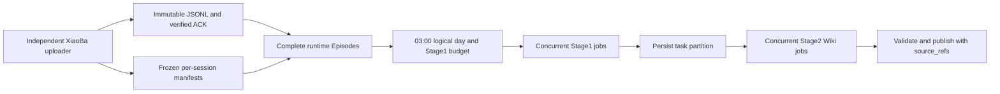

# Historical ingestion and concurrent memory stages

This change keeps the anchored Stage1 task-partition prompt, all public query/message input, disabled relations, direct Stage2 Markdown generation, schema retries and program-owned Episode references. It adds our own XiaoBa upload protocol, server Episode planning and persistent stage tasks. It does not build semantic edges.

## Data flow



The uploader freezes all old file prefixes at first discovery; it does not use previous CatsLog or Monday upload markers. Future discovery is at Beijing 03:00 and 15:00. Transferred chunks are not model batches. The receiver indexes changes in acknowledged manifest prefixes. Complete files and earlier closed logical days can process while another file is still arriving; an incomplete file holds its current logical-day tail. Missing run boundaries or sequence gaps always hold the affected Episode. Later material produces supplementary batches without reopening published ones. Ready sessions rotate so blocked sessions cannot occupy the first planning page indefinitely. Backfill waiting does not block independently complete incremental Episodes.

The receiver reassembles transcript runs across files and streams with their native conversation/run identity. It requires run_started/run_finished and an unbroken transcript sequence in that interval. Completed, failed and cancelled run endings are accepted. An idle file does not close a run. Pending inputs stay with their runtime Episode. Matching aggregate turn summaries are suppressed when transcript material exists. Legacy aggregate turns remain whole, with only the content they recorded; missing historical messages are not reconstructed. Unknown legacy dates remain unknown.

All original record types remain stored. Episode planning reads only `transcript` and `turn` metadata; runtime/prompt-trace/subagent records have no semantic events in this adapter and are excluded before materialization. Pipeline concurrency and token budgets are the only active controls; obsolete byte-budget and whole-run-concurrency aliases have been removed.

The ingestion boundary has three owners. `ingestion/manifests.ts` advances the existing manifest index offsets together with the derived Episode update in one transaction per manifest. It reads only newly received byte ranges, including replay receipts; it does not rescan an entire session for each uploaded chunk. `ingestion/episodes.ts` refreshes only affected native runs, with indexed run identity and sequence checks. A runless receipt can close a known sequence gap. `ingestion/batches.ts` applies the date and token policy to ready Episodes outside a database transaction, then atomically publishes each batch and its Episode ownership. `IngestionPlanner` only holds the single-planner lease and rotates eligible sessions. Crashing between indexing and publication leaves durable ready Episodes for the next cycle, not a partially published batch.

Closed Episodes become eligible ten minutes after their ending. An Episode crossing 03:00 belongs wholly to its starting logical day. Daily Stage1 inputs target 200K tokens including prompt/schema overhead; packing preserves Episode order, with a two-batch rebalance for tails under 50K. At most two consecutive logical days merge when their combined Stage1 request is at most 100K. No semantic cut-point model or overlap is added. One Episode exceeding the soft target can run independently within the hard input budget.

For each Stage1 task, the existing query assignment candidate logic selects material. Candidate selection remains query-scoped: a root and pending query assigned to different tasks retain their own selected material. When several selected segments share a runtime Episode, request splitting keeps them together. Stage2 normally creates one Wiki. Only oversized candidates are packed between complete runtime Episodes into scoped document parts; exact final payload checks refine the plan before publication. One indivisible oversized Episode is deferred and visible. The entire Stage2 plan and its publication flag commit atomically. Part identities prevent later output overwriting earlier parts. A successful Wiki is immediately searchable even if another task fails.

## Stage concurrency

Persistent `extraction_runs` represent Stage1 and batch summaries; `memory_tasks` represent Stage2 document parts. Stage1 saves its result and tasks, releases its execution slot and immediately processes another batch. Stage2 tasks only run after the complete partition/task plan is published. Independent Stage1 calls, independent Stage2 calls and cross-batch Stage1/Stage2 calls overlap.

Defaults: Stage1 maximum 2, Stage2 maximum 6, global in-flight stage jobs maximum 6. With both queues available, aim for 2 Stage1 + 4 Stage2; Stage2 can borrow all 6 when Stage1 is empty. Stage2 high-water backpressure limits further Stage1 admission. Each completed stage job replenishes capacity immediately. History/new lanes and authorized bot sources rotate within each stage. No extra per-bot model pool is multiplied onto these limits. Retries inside one schema call remain bounded by its occupied stage slot; they cannot exceed the global maximum.

One coordinator holds an advisory lock. Restart recovers abandoned running stage tasks, reuses stored partitions and preserves successful documents. This is bounded asynchronous execution on one Node process, not a multi-host worker architecture. A database pool of 5 remains configurable by `DATABASE_POOL_MAX`; large candidates are only materialized for active work. Raise concurrency only after measuring host memory, database waits and provider limits. Remote LLM computation needs no local GPU.

## Budgets and configuration

Use the matching model's Hugging Face `tokenizer.json` via `MODEL_TOKENIZER_FILE`; the implementation counts bounded 64K-character slices and adds request framing allowance. Missing tokenizer uses UTF-8 bytes conservatively and reports that method in batch requests. It never assumes a fixed Chinese-character/token ratio. Validate the tokenizer against provider usage before increasing limits. Every dispatch and schema-feedback retry rechecks actual serialized messages/tools plus configured output and margin. Keep thinking enabled, effort max and output 131072.

Default context 1048576, margin 37504, Stage1 target 200000, Stage2 target 880000. Targets are tunable and are not claims of an optimal quality point. The HTTP 4 MiB body limit remains; the obsolete normalized-input 4 MiB limit no longer determines new memory-model eligibility. Oversized/deferred work is recorded instead of repeatedly spending model tokens.

## Protocol and inspection

Project routes require the existing Bearer key. The separate Bot upload ingress is keyless: `/v1/bot-ingest/config` supplies the dataset identifier, and `/v1/bots/{uid}/ingest/{manifests,batches,fragments}` accepts original logs by Bot UID. UID is declared provenance, not caller authentication. Upload callers do not choose a project; `MEMORY_BOT_PROJECT_ID` selects the server-owned workspace (default `prj_bot_uploads`, created automatically). Search, workbench, extraction inspection/retry and original-source reads retain project authorization. Dataset fencing applies to Bot uploads as well as the project upload routes. Stable source identity does not depend on key text.

Bot uploads normalize `usr365` to UID `365`, namespace each installation source under that UID and update the `ingestion_bots` display name on each request carrying a name. Records with a conflicting explicit Bot identity are rejected atomically. Original JSONL bytes stay intact; normalized metadata records the Bot UID and whether its attribution was recorded or upload-declared. The workbench resolves names from the Bot registry, so a rename updates existing views without rewriting raw records. The adapter, Episode planner, stage queues, Markdown generation and source references are shared with project uploads.

`POST /v1/ingest/manifests`:

```json
{"dataset_id":"rebuild-v1","source_id":"bot-stable-id","manifest_id":"scan-id","session_key":"cli/cli_session.jsonl","lane":"backfill","files":[{"stream_id":"transport-id","end_offset":2048,"path":"sessions/cli/2026-11-17/cli_session.jsonl"}]}
```

Then use `/v1/ingest/batches` with the existing original-record protocol plus `dataset_id`. The response additionally includes SHA-256 of the concatenated submitted raw bytes. Replays at the same origin coordinates/hash reuse canonical raw/event references, including another transport stream; overlapping changed bytes are rejected. Byte ACK and manifest acceptance are not model completion.

For a single JSONL line larger than 1 MiB, use `/v1/ingest/fragments` with `source_id`, `stream_id`, `record_offset`, `fragment_offset`, `total_bytes`, `record_hash`, the original `origin`, and `raw_base64` for at most 1 MiB. Fragments persist across restart and support identical replay. Each incoming fragment checks saved descriptors and only reads a matching old payload for replay; all payload bytes are assembled once when the whole record is available. Only after the complete line's SHA-256 and newline verify does the normal ingest transaction publish original bytes and normalized events. Only that final response contains `next_offset` and `sha256`; intermediate `next_fragment_offset` never advances the uploader's record checkpoint. The first implementation supports whole records up to 64 MiB (the observed history maximum was about 25.5 MB). Larger records remain local with a visible file error and stop that file range; other files continue. Unfinished fragments remain in the database for resume and are removed on final publication or explicit dataset reset.

`GET /v1/ingest/status` reports manifest states, Episode states/reasons, run states, Stage2 task states and published Wiki count. `/v1/extractions/:id` additionally returns each task's part index/count/status/error and published document parts. Existing memory search remains deduplicated before the ten-document limit; Episode/raw reading preserves project authorization.

`POST /v1/extractions/:id/retry` is project-authorized and retries a saved run directly, including cross-file runs. It reuses the stored Stage1 partition and published Wiki documents and queues only failed tasks, or the failed Stage1 when no plan was published. Oversized deferred parts do not automatically retry or spend tokens again; completed/active runs remain unchanged. This avoids reconstructing a different single-stream snapshot merely to retry a historical batch.

## Clean rebuild

Do not clear production during automated tests. Stop all old uploaders and the memory service, then run:

```sh
npm run admin -- dataset-clear PROJECT_ID --workers-stopped --confirm=PROJECT_ID
```

The command transactionally clears only that project's original memory data, pending jobs and Wiki products, retaining project keys. It refuses when the coordinator or planner lock is held. Set a new `MEMORY_DATASET_ID`, archive the independent uploader's old state, then start one new uploader and the service. Bot uploaders discover the new dataset automatically from the server. Original bot logs and third-party state remain intact. Old dataset uploads must remain blocked; ordinary restarts must never perform a reset.

## Requirements and review gates

Verify full historical coverage plus incrementals; no dependency on CatsLog; immutable complete-line transfer and ACK recovery; complete runtime Episodes and all recorded messages; date/size packing and small-tail handling; Stage2-only oversize fallback; actual stage overlap and bounded concurrency; reuse successful results on retry/restart; project isolation, search and original citation reads; dataset-fenced clean rebuild. Record real-log input/output, model usage, retries, deferred items, task allocation and omissions separately from deterministic integration tests.
