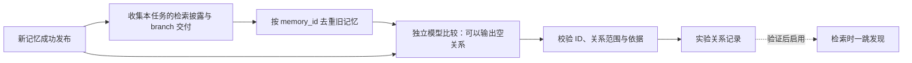

# 记忆工作台与检索后建边方案

状态：工作台第一版已实现，等待 PR CI 与合并。以 2026-11-11 的服务代码 `e87faad` 为基线。本版不调整提取提示词，也不实现检索遥测或语义关系边。

## 要解决的问题

使用 Agent 的人应能看清：日志是否上传、哪些历史进入了处理、如何划成任务、每个任务生成了什么记忆、关键词能否找回记忆、引用能否回到原始上下文。后续再记录新任务得到过哪些旧记忆，并在新记忆生成后判断是否值得连接。

当前的 Markdown 是历史记忆，可以记录执行过程、讨论、偏好、错误和未定结论。它不必须是可执行 skill，也不承担证明历史说法客观正确的责任。原文、生成记忆、检索披露、模型判断之间的区别必须保留。

## 本版交付范围

先交付 A：连接现有服务的真实工作台。

- 一个同源网页，使用现有项目 Key。
- 日志流与处理批次列表，展示原文接收、处理状态、已发布文档数和实际保存的错误。
- 默认二维分层来源图，选择上传、任务、Episode 或记忆时联动。
- 查看完整 Markdown、Stage1 任务说明与归属理由、预选轮次、分页原文及原始字节。
- 手动调用真实 Markdown 搜索，支持 AND 和 OR，按文档去重后每次最多 10 篇。
- 点击命中项定位生成路径，点击 source_refs 查看对应 Episode 原文。
- 增加新上传数据的服务端接收时间；历史接收时间保持未知。

接着交付 B：最小检索记录。它需要 harness 配合，不能只靠服务器搜索日志推断。

- 保存搜索返回了哪些 memory_id。
- 直接模式记录工具结果实际注入的文档；branch 模式额外记录交给主 Agent 的内容和来源 ID。
- 将检索或交付绑定到实际 query、turn，再映射到新任务。
- 在工作台展示本次任务与旧记忆之间的检索路径。

C 是后续小实验：新记忆发布后的保守关系判断。先验证输入、输出及误连情况，再启用持久语义边和沿边检索。A 的验收不依赖 B、C，B 也不要求先实现 C。

本版不扩展注册系统、不建图数据库、不做三维场景、不增加向量检索、不回填全部旧日志、不改变 Stage1 和 Stage2、不恢复 event 删减步骤。

## 现有链路保持什么


Stage1 仅看上传记录里实际存在的 query 和 message，不输入工具日志。所谓全部 message 不代表可以补回 harness 从未记录的轮内消息。工作台可披露事件类型和数量，但不能宣称旧日志已经完整。

Stage1 输出 `task_threads`、`query_assignments` 和结构上保留的 `relations`。当前记忆链路要求 `relations=[]`。工作台不重新开启这部分建边。

Stage2 的输入仍是单个 task_thread、该任务的 query_assignments 和完整预选轮次，含 query、message、tool_call、tool_result。它直接生成固定 Markdown 骨架，程序机械附加 Episode 引用。

当前 Episode 与 Markdown 在生成成功后同一事务创建。尚未成功的任务只能展示“预选上下文”，不能冒充已有可读取的持久 Episode。

## 工作台如何使用

```text
┌─────────────────────────────────────────────────────────────┐
│ 项目连接状态    搜索关键词 [                 ]  AND / OR  搜索 │
├──────────────┬─────────────────────────────┬──────────────────┤
│ 日志流        │ 二维来源图                   │ 内容检查          │
│ harness       │                             │ 任务说明          │
│ source/stream │ 原日志 → 固定处理快照         │ 完整 Markdown     │
│ 已接收字节    │                ↓            │ 候选轮次与共享情况 │
│ 处理批次      │              任务           │ 分页原始对话      │
│ 状态与文档数  │                ↓            │ 工具调用与结果    │
│              │             Episode → 记忆   │ 原始字节与 hash   │
└──────────────┴─────────────────────────────┴──────────────────┘
```

打开后输入项目 Key，左侧立即显示该项目的日志流。选择一个处理批次，中央展开它的任务和已生成记忆。点击任务可看任务描述、对应轮次及归属理由；点击记忆可读全文；点击引用可回查原文。

搜索默认查项目内全部已发布 Markdown，不能因为选中了左侧某次上传而悄悄缩小搜索范围。点击结果后切换到该结果自己的 run 并高亮来源路径。手动搜索本身不触发生成，也不创建语义边。

中央主图聚合显示任务和 Episode。大段 query、message、tool_call、tool_result 在右侧按原顺序展开，使用文字和形状区分，避免用颜色作为唯一标识。事件不全部铺成图节点。窄屏改为列表、图、详情切换视图。

没有实际上传名称时显示 harness 和截短 ID，不根据 UUID 猜测主机名或文件名。将来可增加上传端提供的显示名，但显示名不参与身份与权限判断。

## 前后映射如何保证准确

| 展示对象 | 确定身份 | 映射依据 |
|---|---|---|
| 上传的日志流 | project_id、source_id、stream_id | streams 与 raw_records |
| 某次处理的固定输入 | run_id | extraction_runs.input_refs 的实际成员和顺序 |
| 某个任务 | run_id、thread_id | task_partition.task_threads |
| query 的任务归属 | query_ref | query_assignments，允许一轮关联多个任务 |
| 成功发布的原文候选 | episode_id | episode_events 的成员与 ordinal |
| 生成记忆 | memory_id | memory_documents 的 run、thread、episode 绑定 |
| 不可变原始记录 | raw_ref | 原始字节、hash 与标准化 event 的 pointer |

日志流可以继续增长，run 的输入快照已经冻结，两者不能画成同一个节点。一个 run 如果确实来自多个流，就展示多个输入；映射缺失时明确标为未知。

共享轮次表示同一段材料被多个任务选用。它不表示两个任务存在语义关系。图中不复制原始存储，也不通过标题匹配。

默认只画确定来源连接。选中任务后高亮它的原文成员，显示候选轮次数、事件数和共享轮次数。计算沿用现有整轮展开规则，不另设一套“轮次”定义。查看跨任务共享时按真实 ID 比较。

### 状态只显示实际能知道的内容

- 上传进度是服务器已确认的字节范围，不是模型已处理进度。
- 有 task_partition，说明 Stage1 结果已经持久保存。
- 有 memory_documents，说明对应任务的 Markdown 已发布。
- 未生成文档时结合 run 的 queued、running、partial、failed 状态展示，不能凭空编造精确的单任务执行进度。
- 当前错误主要存于 run.error。先展示它，不用字符串猜测不存在的结构化错误阶段。

当前没有逐次 HTTP 上传请求的审计表。第一版左栏准确说是“日志流与处理批次”，不声称还原每次上传请求。增加 nullable raw_records.received_at，新记录保存真实服务端接收时间；历史 null 显示未知，来源日志时间单独标注。

## 服务端与接口怎么做

选择“按 run 查询现有 PostgreSQL 的来源投影”。每次选中 run，服务端组合已有 ID 与外键返回图。来源边不另存一份，不引入通用图数据库。

| 操作 | 接口设计 | 边界 |
|---|---|---|
| 列出日志流 | 新增 GET /v1/workbench/streams | 分页汇总流、接收范围、数量和已知接收时间 |
| 列出处理批次 | 新增 GET /v1/workbench/runs | 按 source/stream 过滤，独立分页，避免把大量 runs 嵌入流列表 |
| 查看分层图 | 新增 GET /v1/workbench/runs/:id/graph | 返回该页任务及对应 Episode、memory 和统计；输入 refs 保留在服务端 |
| 查看快照或任务候选原文 | 新增 GET /v1/workbench/runs/:id/events | 数据库按序分页；可指定 thread_id，复用整轮选择规则 |
| 按 ID 读记忆 | 新增 GET /v1/memories/:id | 返回 run_id、thread_id、完整 Markdown 与 source_refs |
| 搜索记忆 | 复用 POST /v1/memories/search | AND/OR、去重后最多 10 篇，完整正文 |
| 查看已发布 Episode | 复用 POST /v1/read | 原有分页与顺序 |
| 查看原始字节 | 复用 GET /v1/raw/:ref | 原始内容及 SHA-256 |

路由名称是建议，接口数量以实现时职责是否独立为准。图接口按任务分页，一页任务携带完整的对应节点与路径，并返回总数和下一页。大列表按需加载，不把“有界”实现成静默截断数据。当前 extraction 状态接口可继续使用，但不是给所有页面倾倒全部 input_refs 的替代品。

搜索和详情共用 Markdown 与 source_refs 格式化函数。存储正文、检索正文和详情正文不能各有一套拼接规则。

所有数据查询沿用项目 Bearer Key。服务端从认证结果得到 project_id，不信任客户端传入项目身份。外项目 ID 与未知 ID 一样不可读取。这里的隔离单位是现有 project：未来如同一项目发放多把 Key，它们会共享项目范围，并非自动变成逐 Key 私有空间。

网页与 API 同源，Key 仅留在当前页面内存，不放 URL 或 localStorage。Markdown 和原始日志是非可信内容，渲染禁用原生 HTML 并过滤链接，不执行其中指令或脚本。采用小型维护中的 Markdown 渲染方案；图用固定分层 SVG 或 HTML，暂不增加前端应用框架。

## 检索记录如何配合 Agent

直接模式：

```text
主 Agent 调搜索 → 服务返回旧记忆全文 → 工具结果进入主 Agent 上下文
                                                ↓
                                  记录实际披露的 memory_id 与所属轮次
```

服务端能记录响应中包含的文档。无需再打开一次全文才能算候选。若 harness 截断或过滤了工具结果，则实际注入范围需要客户端报告；服务器响应不等于证明主 Agent 完整接收、理解或使用。

branch 模式：

```text
主 Agent 委派 → branch 搜索收到全文 → branch 选择并交付 → 主 Agent 获得内容
                      ↓                  ↓
                  返回文档 IDs        实际交付 IDs、全文/摘录/摘要、来源
```

branch 找到但没有交付的材料，可保留在 branch 的检索记录里，不默认当作主任务参考。branch 交付摘要时记录其来源 IDs 与实际交付文本引用，不声称主 Agent 读过完整旧文档。

“明确引用”能检测到，但“实际上用了多少”通常只能推断。第一步不增加一个 LLM 去判定使用率，也不把是否在最终回复点名当作建边前置条件。

### 最小记录内容

搜索成功响应可新增 retrieval_id，同时保留现有 items 和 source_refs。服务端保存项目、关键词、AND/OR、返回的 memory_ids 及时间。客户端补报 retrieval_id、接收者、实际注入或交付的 memory_ids、内容形式，以及 source/stream 和本地轮次标识。

客户端标识需要能在上传后解析为 query_ref 或 event_ref。上传前先留待绑定，解析不到则标记未绑定，不猜到某个任务。使用客户端事件 ID 做幂等，重复报告不重复累计。最小可增加一个 POST /v1/retrievals/events 接口接收这类报告，不先建立通用遥测平台。

随后利用 Stage1 的 query_assignments，将这一轮的检索或交付归入相应任务。允许一轮对应多任务，但这只是候选关联，仍不表示每篇新记忆实际使用了全部结果。手动工作台搜索没有明确任务绑定时，仅作为人工检索记录。

未来记忆生成时，检索结果中嵌入的旧 wiki 内容属于历史参考，不能被误当成本次重新执行的动作或用户的新决定。这一点列入新增闭环测试；不能因为加入建边就放松已有的来源、说话人和时间限定。

## 新记忆发布后如何建边



候选来自本任务实际获得的历史记忆。直接模式取实际注入候选；branch 模式取交付给主 Agent 的候选及可追溯来源的摘要。服务端只掌握返回记录而没有客户端注入报告时，最多标为“可能披露”，不能声称已经使用。未能绑定任务的搜索记录不用于自动语义建边。

不能将整场会话的全部命中与每篇新 wiki 两两比较。候选有多批时逐批比较，记录未完成批次，不静默丢弃。新旧同一 memory_id 排除，不通过标题或字符串相同判断身份。

### 关系判断的输入和输出

输入包含新 memory_id 与正文、本任务范围、去重的候选旧 memory_id 与正文、检索或交付来源、各文档绑定的 Episode 引用。需要澄清的任务依据按预算提供。不能要求模型自行补回未提供的上下文。

输出为标准 JSON 的 relations 数组，允许为空。每条最少包含 from_memory_id、to_memory_id、kind、scope、explanation 和 evidence。初步只考虑 supplements、corrects、supersedes、continues。方向固定为新文档指向被补充、纠正、取代或接续的旧文档。

evidence 给出新旧文档中支持关系的短原句及所属 memory_id，由程序校验引用对象和文本确实存在。Episode 引用由程序绑定，不让模型生成新原文 ID。记忆中的原句只能支持“历史记载之间存在这一关系”，不能充当外部核验。字段缺少、引用越界、正文不完整或多个互相矛盾的目标均拒绝并有限重试，不补造内容。

提示词核心要求：

- 同主题、同关键词、共同命中或时间接近均不构成关系。
- 必须说清具体补充、纠正或接续了哪一部分；无法指出则输出空数组。
- 保留说话人、环境、时间和条件，不能凭较新的文档就裁定较旧文档错误。
- 新任务参考过旧文档可以只保存检索记录，不必产生语义边。
- 不复制新旧正文，不把任务参考关系包装成事实依赖。

语义判断主要由 prompt 与 schema 完成，但工程仍须负责候选收集、任务绑定、权限、校验、幂等、任务恢复与展示。单纯在 Stage2 输出里加几个字段，不能替代这些职责。

### 存储和失败处理

关系独立保存，保留端点、类型、范围、说明、依据、模型与 prompt 版本，以及必要的生成任务状态。以新旧文档和判断版本形成可重试的任务身份，结果重试不能重复插边。

关系处理在 Markdown 发布之后异步执行。失败只影响关系状态，不能撤销或阻塞已经发布的记忆，也不自动修改旧文档结论。实验期关系可在工作台查看，先不参与搜索扩展。验证误连可接受后，可采用保守自动接受策略，不强制增加每条人工审核流程。

关系说明在文档侧栏或独立 related_memories 中展示，不混入原有 Markdown 的事实正文，也不让关系说明自动污染字面搜索。后续若渲染交叉引用，由程序从关系表生成。

业务上从两端都能发现，但界面显示语义方向。例如新文档“纠正”旧文档，从旧文档也能看到“有后续纠正”。以后沿边检索只扩一跳，标明字面命中或沿边发现，按 memory_id 合并去重后仍最多 10 篇。涉及旧结论的后续纠正应突出说明；具体排序作为沿边检索启用时的独立设计，不顺带改当前搜索。

## 为什么选这套结构

比较了两种整体方案。

| 方案 | 适合什么 | 当前代价 | 决定 |
|---|---|---|---|
| 按 run 读取现有表，生成来源图 | 选择上传、核查生成、回查原文 | 增加少量项目范围的读取接口 | 本版采用 |
| 通用 graph neighborhood API | 任意节点扩展、多种图遍历 | 需为所有节点定义授权、分页和展开；查看一次 run 仍可能多次请求 | 暂缓，保留清晰的节点身份和边类型 |

来源映射与模型语义关系分开存取，页面以后可以叠加显示。这样增加语义边不会改变原始引用，也不用同步维护两份来源图。

应用 pstack 的原则形成了三个具体选择：Experience First 使工作台围绕查上传、看生成、搜回记忆组织，默认二维；Model the Domain 使 stream、run、task、Episode、memory 身份及披露、交付、推断分开；Laziness Protocol 使来源图直接读取 PostgreSQL，复用现有搜索和原文接口，不创建图数据库或通用事件框架。

## 实施顺序与验收

实现状态（2026-11-11）：工作台页面、项目 Key 认证读取路由、流和 run 投影、固定输入事件分页、记忆详情与接收时间迁移已落到实现分支。日志流先分页再统计；Episode 查询也只聚合当前图页任务，避免翻页时重复处理整批数据。应用继续在服务器 loopback 监听，由 Monday 现有 Nginx 增加 HTTPS 公网入口，工作台与 API 同源访问。当前实现尚未合并或部署；完整测试通过，Nginx 当前只有 80 端口监听，仍需配置已解析域名、TLS 证书和 443 server block。Monday 部署使用独立测试数据库，不触碰生产库。

A1：补接收时间，完成项目范围的流、run、图和文档详情读取。用真实 PostgreSQL 核对无 run 的上传、多个 run、历史时间未知、部分成功和外项目引用。

A2：实现同源网页，接通列表、二维图、Markdown、任务说明、原文分页和搜索。先用一条开发长会话和一条非开发长会话演示完整来源路径，不以空白图或静态假数据作为验收。

A3：核对候选轮次和共享轮次是否与现有选择函数一致，搜索与详情正文是否一致，工具调用和结果是否按原始记录显示。覆盖空结果、401、404、部分失败、很长 Episode、图分页及非可信 Markdown 渲染。

A4：按既有流程先合并，再部署 Monday，使用真实授权 Key 验收。记录部署 SHA，给出可访问的工作台地址、真实上传与生成数量、实际搜索命中正文及原文回查结果。失败则披露失败范围，不只报“通过”。部署工作台不触发全量历史上传。

B：先选一种实际 harness 接入最小检索报告，验证直接返回和 branch 交付两条链。演示多个任务混在同一会话时，旧记忆是否正确归入对应任务。缺报告或无法绑定时明确显示缺口。

C：固定新记忆与其真实旧记忆候选做关系试验，包含应为空、确有补充、条件不同、仅同主题、助手提出纠正未验证、branch 未交付和跨项目引用。逐条展示原始输出、通过或拒绝原因、误连与漏连，再决定是否启用持久边和一跳扩展。

A 的完成标准是可以当场完成：选择一次实际上传 → 看清处理与任务 → 读到记忆 → 搜索命中 → 按引用读回原文。B、C 有各自验收，不把它们含糊算进“工作台已经完成”。

## 依据与审查限度

现状依据为 src/app.ts、src/memories.ts、src/read.ts、src/ingest.ts、src/extraction/memory-runner.ts、src/extraction/model.ts、src/db/migrations 和 docs/api.md，以及相关仓库规格与 git 历史。此次没有连接 Monday 核对在线数据数量，不报告部署已经完成。

已取得一个独立候选 .audit/candidates/projection.md。第二个独立设计代理未收到有效任务正文，未产出可用方案；graph-domain.md 是主代理补写的结构备选，不算独立审查。完成了代码依据核对和两结构比较，尚未完成 pstack 完整多模型交叉评审，也未进行产品代码测试。
